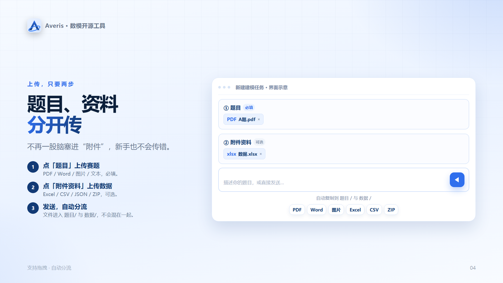
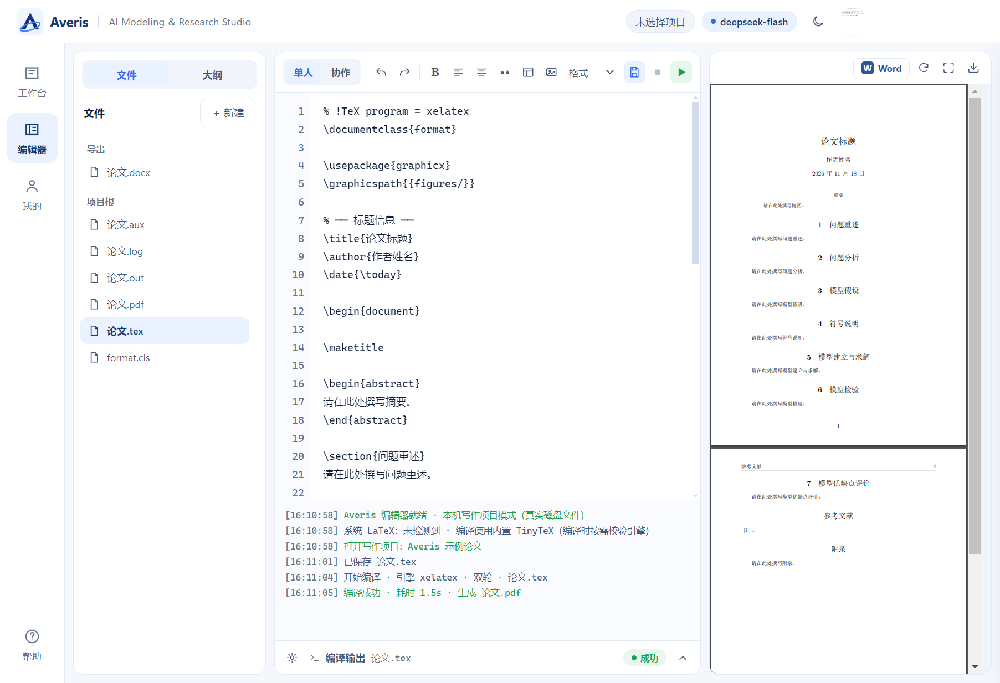

# Averis

**小白必备的全流程数模解题工作台，免费开源。**  
面向第一次参加数维杯、亚太杯、美赛的同学：把读题、建模、求解、论文排版放进同一条工作流。

> 本仓库只包含**客户端 UI 与框架代码**。求解内核、论文规则库与提示词资产不包含在内，因此本仓库不能单独构建出完整求解客户端；Windows 安装包通过 Releases / 交流群发布。





## 它能做什么

- **题目 / 附件资料分开上传**：题目必填，数据可选，文件自动进入 `题目/` 与 `数据/`，不再混在一个“附件”里。
- **一条链路跑完**：读题 → 建模 → 求解 → 验证 → 论文写作 → 编译导出。
- **PDF + Word 双导出**：论文、图表、代码、结果表统一整理。
- **内置 LaTeX 工作台**：左侧源码、右侧 PDF 预览，改完重新编译；不用另外折腾 TeX 环境。
- **多模型接入**：DeepSeek、Kimi、智谱 GLM、通义千问、OpenAI 等（使用你自己的 API Key）。
- **本地工作区**：项目文件保存在本机；调用模型时，题面与数据会发送到你配置的模型服务商。

## 快速开始

1. 获取 Windows 客户端（Releases 或交流群）。
2. 在「求解配置」中填入模型 API Key，选择模型。
3. 点「题目」上传赛题，点「附件资料」上传数据。
4. 发送任务，等待求解完成，在产出面板打开 PDF / Word / LaTeX 工程。

> 浏览器直接打开 `client/index.html` 可以体验界面与演示流程；真实求解、编译与导出需要 Windows 客户端。

## 开源范围

本仓库采用 **AGPL-3.0-only + 商业双授权**：

- 开源：`client/` 下的客户端 UI 与框架代码。
- 私有：求解内核、Agent 调度、论文规则/模板/提示词、构建脚本与安装包。
- 商业使用、闭源分发、SaaS 化：需要单独商业授权，请开 Issue 联系。

详见 [LICENSING.md](LICENSING.md) 与 [LICENSE](LICENSE)。

## 数维杯秋季赛信息（2026）

- 竞赛时间：**2026 年 11 月 20 日 09:00 — 11 月 24 日 09:00**（96 小时）
- 报名截止：2026 年 11 月 20 日 06:00
- 论文提交截止：2026 年 11 月 24 日 10:00
- 赛制：全英文论文；MCM / ICM 双赛道；A / B / C / D 任选一题
- 官网：[nmmcm.org.cn](https://www.nmmcm.org.cn/)

以上信息整理自官方公开通知，**以官网最新通知为准**。

## AI 使用与学术诚信

Averis 是辅助工具，不是代写工具：

- 生成内容必须由你独立核验、修改并对结果负责。
- 参加竞赛前，请阅读该赛事的 AI 工具使用规定，按要求声明。
- 不要伪造数据、代码、运行结果或引用。

## 开发

客户端为原生 HTML / CSS / JavaScript，零前端构建依赖。`client/bridge.js` 负责与 Electron 主进程通信；仓库不包含主进程与内核实现。

```text
client/
  index.html   界面结构
  styles.css   设计系统
  app.js       交互、演示流程、配置
  bridge.js    Electron / 浏览器桥接
assets/        图标与界面截图
```

## License

- 客户端代码：**AGPL-3.0-only**
- 商业授权：见 [LICENSING.md](LICENSING.md)
- 版权与排除范围：见 [NOTICE](NOTICE)

Copyright (C) 2026 Averis authors.